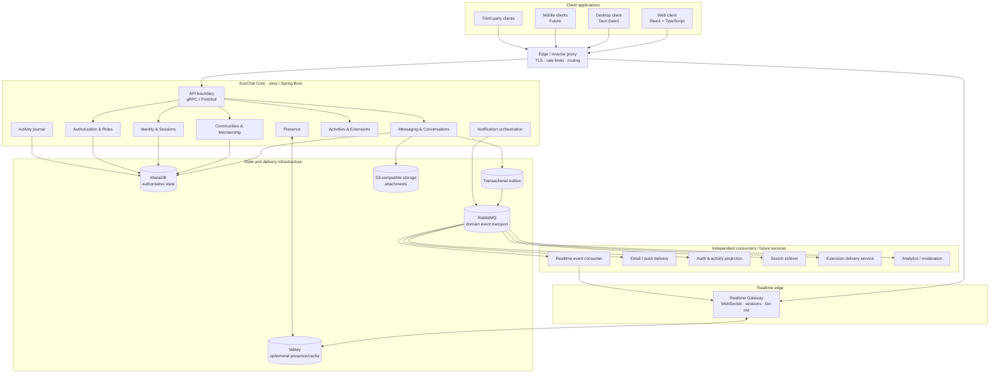
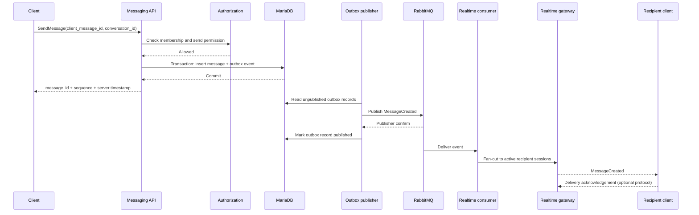

# ExoChat System Architecture

## Architectural approach

Use a **modular monolith first**, with event-driven integration boundaries. Extract a module into an independently deployed service only when it has a distinct scaling profile, operational boundary or ownership need.

This preserves a path to distributed services without imposing microservice operations on a solo developer.

## Logical service diagram

## Request path: send message

The client acknowledgement is tied to the database commit, not to email, journal, search or extension consumers.

## Module boundaries

| Module | Owns |
|---|---|
| Identity | Users, credentials, sessions, account lifecycle |
| Community | Communities, memberships, invitations |
| Authorization | Roles, policies and permission evaluation |
| Messaging | Conversations, messages, reactions, sequence allocation |
| Content | Attachment metadata and upload authorization |
| Presence | Ephemeral online state and typing indicators |
| Notifications | Preferences and delivery orchestration |
| Journal | Durable user-facing activity projections and audit records |
| Activities | Activity sessions and lifecycle |
| Extensions | Manifests, installs, grants, versions |
| Integrations | External provider credentials and adapters |

## Initial deployment topology

Start with:
- `exochat-api`: Spring Boot application
- `exochat-worker`: outbox publisher and event consumers
- MariaDB
- RabbitMQ
- Valkey
- S3-compatible object storage
- Reverse proxy / TLS termination

The realtime gateway can initially be part of the Java deployment. Extract it into Rust only after load tests show a meaningful benefit.

## Communication rules

- Synchronous commands/queries use typed application APIs.
- Domain events represent facts that have already committed.
- No consumer is in the critical path for message persistence.
- Modules do not query another module's tables directly.
- Event consumers are idempotent.
- No global ordering assumption across RabbitMQ consumers.
- Use per-conversation sequence numbers for message ordering.
